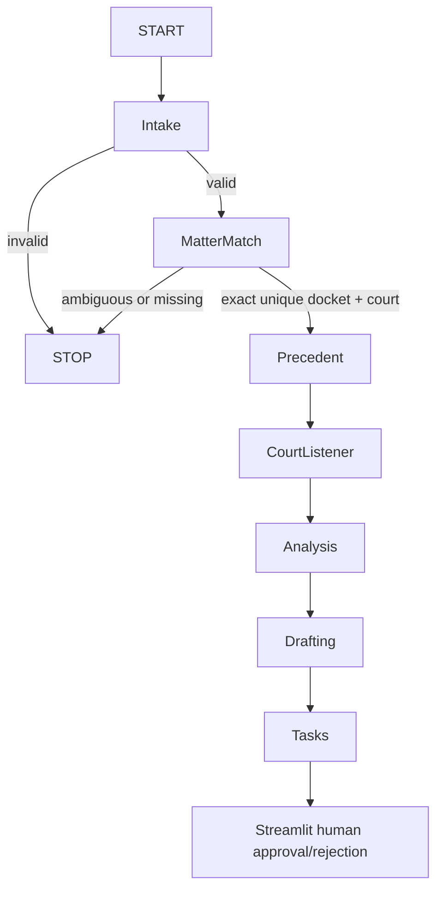
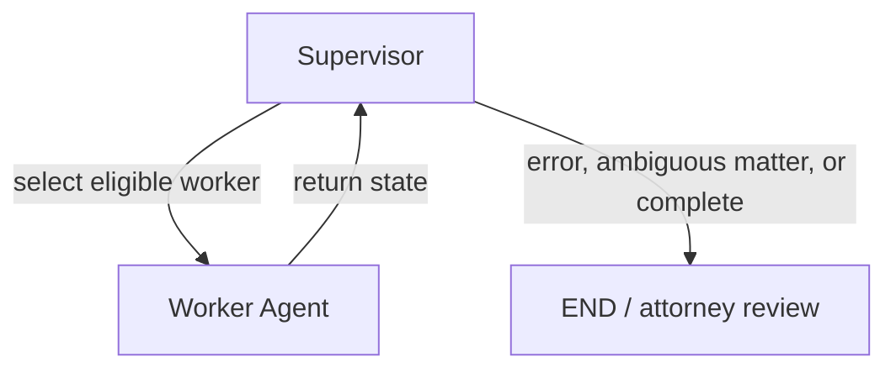

# Litigation Multi-Agent Workflow (LangGraph + Streamlit)

A runnable **educational prototype**, not a production law-firm system or a legal advice engine.

## Quick start

Requires Python 3.10+ (3.11 recommended).

```bash
python -m venv .venv
# Windows:
.venv\Scripts\activate
# macOS/Linux: source .venv/bin/activate
pip install -r requirements.txt
copy .env.example .env    # Windows; on macOS/Linux use: cp .env.example .env
streamlit run streamlit_app.py
```

Open the Streamlit address displayed in the terminal (usually http://localhost:8501).

No API keys needed to run the synthetic demo. For actual AI-generated memo drafts, set `OPENAI_API_KEY` in `.env`. To optionally try external CourtListener searches, set `ENABLE_COURTLISTENER=1` and optionally `COURTLISTENER_TOKEN`. API access, schema and rate limits can change; errors are reported as unavailable research, not fabricated results.

## Workflow graph



## Agent responsibilities

- **Intake agent**: validates a manually submitted event. It does **not** poll a court docket.
- **Matter agent**: matches by exact docket number AND court. Stops on ambiguity.
- **Precedent agent**: keyword-searches synthetic local precedent JSON. Does not access iManage.
- **Case-law agent**: optional CourtListener search leads, not validated citations or holdings.
- **Analysis agent**: AI-generated preliminary memo when configured; deterministic placeholder otherwise.
- **Drafting agent**: creates an internal draft, not a court-ready filing.
- **Task agent**: proposes four tasks with no calculated deadlines.
- **Human review**: separate Streamlit approval/rejection step; no automated emails or court filings.

## Files

- `graph.py`: LangGraph nodes, edges, conditional routing, shared state schema.
- `agents/nodes.py`: individually commented agent implementations.
- `streamlit_app.py`: intake, review and audit UI.
- `storage.py`: local JSON storage (demo only).
- `export_docx.py`: Word draft export.
- `sample_*.json`: synthetic data.
- `tests/test_workflow.py`: smoke tests.

## Tests

```bash
pytest -q
```

## Limitations and production roadmap

1. **No automatic court event detection.** Add a scheduled, authenticated docket ingestion service (CourtListener RECAP, PACER, or another licensed feed) with deduplication, provenance, and retry handling.
2. **No real document-management integration.** Replace synthetic precedent search with access-controlled iManage/NetDocuments APIs, respecting ethical walls, document permissions, and retention policies.
3. **No verified deadline engine.** Deadline rules depend on jurisdiction, judge, case type, local rules, service method, holidays, and orders. A qualified attorney must verify and approve deadlines before calendar/task creation.
4. **No Microsoft Graph write integration.** Add OAuth, delegated permissions, idempotent writes, conflict handling, and an explicit publish step after attorney approval.
5. **Security is demo-only.** JSON files are unencrypted and lack multi-user access controls. Do not input client secrets, privileged records, or real confidential filings. Production requires SSO/RBAC, audit immutability, encryption, secrets management, data-processing agreements, and retention controls.
6. **Research is not authoritative.** Verify original opinions, subsequent treatment, jurisdiction, and citation accuracy. The model may be wrong.
7. **Human review is in Streamlit, not a durable LangGraph interrupt.** For production, add a persistent checkpointer, resumable interrupts, job queue, and concurrent user locking.

No external system is written to by this demo. Only local JSON and downloaded DOCX files are created.

## Supervisor agent (new)

`graph.py` now implements a **supervisor-driven graph** rather than a fixed chain.
Every worker returns to the supervisor. The supervisor inspects `completed`,
`status`, and `error`, selects an eligible worker using explicit prerequisite
rules, and records every decision in `supervisor_history`. This is a
**deterministic supervisor agent**, not an LLM planner. It is deliberately
constrained for legal safety and predictable execution. It stops on intake
errors or ambiguous matter matching. The Streamlit UI displays routing history.
No LangGraph `interrupt()` or `Command()` is used.

### Supervisor edges



### Outlook integration (future adapter)

Microsoft Outlook is an email/calendar client. Microsoft Graph is its cloud API.
Register an application in Microsoft Entra ID, configure delegated OAuth and
least-privilege permissions, then call Graph endpoints to create **draft**
messages and calendar/task proposals after attorney approval. Never send
messages automatically in the demo. Prefer delegated scopes and tenant-approved
mailbox restrictions. Do not put client secrets in source control.

### iManage integration (future adapter)

iManage Work is a law-firm document and email management system. Request an
approved OAuth application registration and tenant-specific API documentation
from the firm's iManage administrator. Replace `precedent_agent`'s local JSON
lookup with permission-filtered iManage matter/document search. Fetch only
permitted documents, preserve source document IDs and version IDs, and ensure
firm confidentiality/AI-vendor policies permit sending excerpts to an LLM.
Do not assume an iManage endpoint or credential format without tenant docs.
